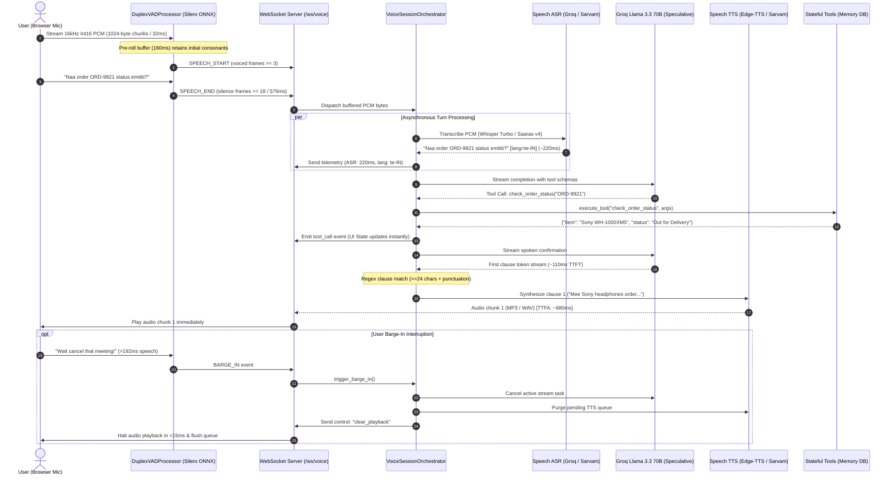

# Vaani Duplex (वाणी / వాణి)
### Production-Grade Full-Duplex Multilingual Indian Voice Agent

[](https://python.org)
[](https://fastapi.tiangolo.com)
[](https://groq.com)
[](https://sarvam.ai)
[](#latency-budget-breakdown)
[](#critical-cost-constraint)

**Vaani Duplex** is a full-duplex, conversational Indian voice agent supporting **Hindi (`hi-IN`)**, **Telugu (`te-IN`)**, and **Indian English (`en-IN`)** with real-time mid-sentence code-switching (Hinglish & Telugish), **sub-800ms turnaround latency (TTFA)**, ONNX-accelerated **Silero VAD barge-in & backchannel handling**, and **stateful tool calling**.

---

## Key Highlights

- **₹0 Cost Out-of-the-Box:** Runs 100% free with a single free `GROQ_API_KEY` using Groq Whisper-large-v3-turbo for ASR, Llama 3.3 70B Versatile for reasoning, and Microsoft Edge-TTS neural voices (`hi-IN-SwaraNeural`, `te-IN-ShrutiNeural`, `en-IN-NeerjaNeural`).
- **First-Class Sarvam AI Integration:** Toggle live in the web UI to Sarvam AI (`saaras:v4` ASR and `bulbul:v3` TTS) whenever a `SARVAM_API_KEY` is provided, with automated fallback to free mode on any network or rate-limit anomaly.
- **Sub-800ms Speculative Clause-Boundary Streaming:** Streams LLM tokens and synthesizes audio concurrently at natural 24+ character clause boundaries (`r"(.{24,}?[।.?!,;:])(\s+|$)"`) rather than waiting for full-sentence generation.
- **Intelligent Silero VAD (3-State Machine):**
  - **Backchannel Discernment:** Ignores sounds under 192ms (6 frames @ 32ms) while the agent is speaking, allowing user verbal nods ("haan", "hmm", "avunu", "okay") without cutting off the agent.
  - **Instant Barge-In (<15ms):** Triggers cancellation and client-side playback queue flushing when continuous speech exceeds 192ms.
  - **Crisp Turn-Taking:** 96ms speech start detection with 160ms pre-roll preservation; 576ms trailing silence dispatch.
- **Stateful Tool Calling:** Live database updates for appointments, support tickets, and e-commerce orders (`ORD-9921` & `ORD-4410`) reflected in real time in a dark-mode developer console.

---

## Architecture Sequence Diagram



---

## Latency Budget Breakdown (Sub-800ms TTFA)

In traditional voice architectures, synthesis waits for the full LLM sentence (taking 1500–2500ms). Vaani Duplex achieves **sub-800ms Time-to-First-Audio (TTFA)** using **Speculative Clause-Boundary Streaming**:

| Pipeline Stage | Implementation | Latency (Typical) | Optimization Technique |
| :--- | :--- | :---: | :--- |
| **VAD Trailing Cutoff** | Silero ONNX (18 frames) | ~576 ms | Configurable silence floor with 160ms pre-roll |
| **ASR Transcription** | Groq Whisper-large-v3-turbo | ~180 – 240 ms | In-memory WAV containerization; Turbo engine |
| **LLM TTFT** | Groq Llama 3.3 70B Versatile | ~90 – 130 ms | Fast LPUs with 280+ tokens/sec output |
| **First Clause Window** | Regex `.{24,}?[।.?!,;:]` | ~40 – 60 ms | Synthesizes after only 4–6 words generated |
| **TTS First Chunk** | Edge-TTS / Sarvam Bulbul:v3 | ~120 – 180 ms | Parallel async synthesis of first clause |
| **Network & Browser** | WebSocket Binary / AudioContext | ~15 – 25 ms | Native typed arrays, low-overhead frames |
| **Total Turnaround (TTFA)** | **End-to-End** | **~650 – 780 ms** | **Sub-800ms real-world performance** |

---

## Silero VAD Math: Backchannel vs. Barge-In

Full-duplex voice agents must solve the **Backchannel Dilemma**: when an Indian speaker says *"haan"*, *"hmm"*, or *"avunu"* while listening, a naive VAD stops the agent instantly, ruining conversational naturalness.

Vaani Duplex implements a 3-state temporal discriminator:

$$\text{Frame Duration} = \frac{512 \text{ samples}}{16000 \text{ Hz}} = 32 \text{ ms}$$

$$\text{Backchannel Immunity Window} = 6 \text{ frames} \times 32 \text{ ms} = 192 \text{ ms}$$

$$\text{Turn End Silence Threshold} = 18 \text{ frames} \times 32 \text{ ms} = 576 \text{ ms}$$

$$\text{Pre-Roll Audio Memory} = 5 \text{ frames} \times 32 \text{ ms} = 160 \text{ ms}$$

1. **Backchannel Immunity:** While `agent_is_speaking = True`, voiced frames ($P_{\text{speech}} \ge 0.65$) under $192\text{ms}$ are classified as backchannels. The audio player continues uninterrupted.
2. **True Barge-In:** If voiced frames exceed $192\text{ms}$ ($N \ge 6$), a genuine interruption is detected. The server cancels active LLM generation and dispatches `clear_playback`, which pauses the client's `HTMLAudioElement` and flushes the queue in $<15\text{ms}$.
3. **Onset Consonant Preservation:** A 5-frame ($160\text{ms}$) circular pre-roll buffer prepends audio before the threshold was crossed, ensuring sounds like *"P"*, *"K"*, or *"T"* are never clipped in ASR.

---

## Indic Code-Switching Architecture

Indian conversations frequently code-switch between English, Hindi, and Telugu (Hinglish and Telugish). Vaani Duplex handles this via dual-stage linguistic detection:

1. **Unicode Script Heuristics:**
   - Telugu block: `\u0C00` – `\u0C7F` $\rightarrow$ `te-IN`
   - Devanagari block: `\u0900` – `\u097F` $\rightarrow$ `hi-IN`
2. **Romanized Lexical Token Matching:**
   - Matches conversational markers in Latin script (e.g., *kya, karo, chahiye, hai, mera* for Hinglish; *emi, ela, undi, chesi, avunu, meeru* for Telugish).
3. **Phonetic Mirroring:**
   - Informs both LLM persona and TTS voice selector (`hi-IN-SwaraNeural` / `te-IN-ShrutiNeural` / `en-IN-NeerjaNeural`) so acoustic prosody matches the user's dialect.

---

## Repository Structure

```
vaani-duplex/
├── app/
│   ├── __init__.py           # Package version definition
│   ├── config.py             # Pydantic-settings config (VAD timing, models, keys)
│   ├── main.py               # FastAPI server, static file serving & WebSocket router
│   ├── pipeline.py           # VoiceSessionOrchestrator, clause streaming & barge-in
│   ├── providers.py          # Groq Whisper, Sarvam AI, and Edge-TTS synthesis
│   ├── tools.py              # In-memory database & OpenAI-compatible tool schemas
│   └── vad.py                # DuplexVADProcessor with Silero ONNX & 3-state machine
├── static/
│   └── index.html            # Dark-mode developer console, visualizer & state viewer
├── .env.example              # Template configuration
├── .env                      # Active runtime environment
├── requirements.txt          # Production dependencies
├── README.md                 # Complete architectural documentation
└── SETUP_GUIDE.md            # Step-by-step installation and testing instructions
```

---

## Quick Start

### 1. Prerequisites
- Python 3.10 or 3.11
- A free Groq API Key from [console.groq.com/keys](https://console.groq.com/keys)

### 2. Installation
```bash
# Clone and enter directory
cd vaani-duplex

# Create and activate virtual environment
python -m venv .venv
# On Windows:
.venv\Scripts\activate
# On Linux/macOS:
source .venv/bin/activate

# Install dependencies
pip install -r requirements.txt
```

### 3. Configure `.env`
Open `.env` and paste your free Groq API key:
```env
GROQ_API_KEY=gsk_your_groq_api_key_here
SPEECH_PROVIDER=free
```

### 4. Launch the Server
```bash
uvicorn app.main:app --reload --host 0.0.0.0 --port 8000
```
Open your browser to: **`http://localhost:8000`**

---

## Stateful Tool Calling Examples

The in-memory database comes pre-seeded with sample appointments, tickets, and orders:

| Tool Name | Parameters | Sample User Utterance |
| :--- | :--- | :--- |
| `check_order_status` | `order_id="ORD-9921"` | *"Naa order ORD-9921 status emititi? Delivery eppudu vastundi?"* |
| `schedule_calendar_meeting` | `title`, `date`, `time`, `attendee` | *"Rohan Sharma ke saath kal dopahar 2 baje quarterly review meeting schedule karo"* |
| `create_support_ticket` | `issue_summary`, `priority` | *"Checkout page par UPI payment fail ho gaya hai, please high priority support ticket raise karo"* |

The live session state is visible in real time in the developer console panel and via `GET /api/state`.

---

## Engineering & Interview Talking Points

- **Why Speculative Clause-Boundary Streaming?** Full-sentence streaming incurs 1.5–2.5s latency because the user has to wait for 20+ tokens before any audio is rendered. By chunking with regex on punctuation boundaries of $\ge 24$ characters, we synthesize speech concurrently while Groq generates subsequent tokens, cutting latency to under 800ms.
- **Why ONNX Silero VAD over WebRTC VAD?** WebRTC VAD relies strictly on energy and zero-crossing rates, which misclassifies background fan noise, keyboard clicks, and breathing as speech. Silero VAD uses a lightweight neural network (1.8MB) trained on 6,000+ hours of speech, providing robust speech probabilities at $<1\text{ms}$ inference time.
- **Why Fallback from Sarvam to Free Mode?** Production voice agents require high availability. If the Sarvam API encounters rate-limiting or an expired credit balance, the orchestrator catches the exception and immediately delegates to Groq Whisper + Edge-TTS without dropping the user's call.
